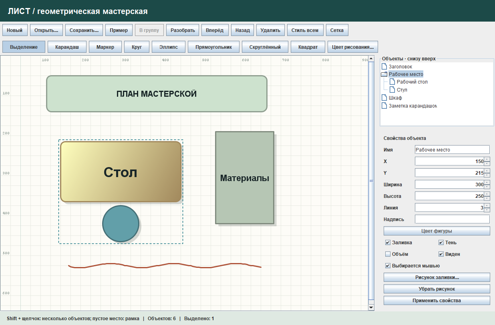

# Лист — графический редактор

Лабораторная работа на Java Swing: рабочий лист с сеткой, рисование от руки,
редактирование фигур и вложенных групп. Проект развивает исходный редактор
`shape-prototype`, сохраняя его пакеты, наследование фигур и разделение MVC.

Задание: [Графический редактор](https://github.com/olgmina/SWEngineering-technics.github.io/blob/gh-pages/Labs/prTask_GraphEditor.md).



## Запуск

Откройте этот каталог в IntelliJ IDEA как Maven-проект. Нужен JDK 17 или новее.
Запустите `com.example.app.Application` или дважды нажмите `run.bat`.
После изменений сначала выполните `build.bat`: он пересобирает JAR и запускает тесты.
Библиотеки приложения входят в JDK; JUnit используется только для тестирования.

В терминале с доступным Maven:

```text
mvn test
mvn package
java -jar target/shape-prototype-1.0-SNAPSHOT.jar
```

Локальный Maven для bat-файлов: `%LOCALAPPDATA%\Programs\ApacheMaven\apache-maven-3.9.9`.

## Как пользоваться

- Нажмите кнопку фигуры, затем щёлкните на листе. Каждый щелчок добавляет новый объект.
- «Выделение»: щелчок выбирает объект, перетаскивание перемещает его. Shift + щелчок
  добавляет или исключает объект. Перетаскивание пустого места выделяет рамкой.
- «Карандаш» и «Маркер» рисуют с зажатой левой кнопкой. Цвет новых объектов выбирается
  кнопкой «Цвет рисования». Цвет существующего объекта меняется в панели свойств.
- «В группу» объединяет несколько объектов одного уровня. Группу можно объединить
  с другой фигурой: получится вложенная структура. «Разобрать» раскрывает один уровень.
- Выберите элемент в дереве справа, чтобы отдельно изменить часть группы.
  Ctrl + щелчок в дереве позволяет выбирать несколько элементов.
- Поля X и Y обозначают левый верхний угол. Размеры и остальные свойства применяются
  кнопкой «Применить свойства». У круга и квадрата высота приравнивается к ширине.
- «Вперёд» и «Назад» отправляют выделение на передний и задний план своего уровня.
- «Рисунок заливки» принимает PNG/JPEG. После выбора нажмите «Применить свойства».
  Изображение хранится внутри документа: исходный файл после сохранения не требуется.
- «Стиль всем» переносит оформление выбранного образца на остальные объекты,
  включая элементы групп, сохраняя геометрию и состояния видимости/доступности.
- Скрытый или закреплённый объект можно снова выбрать в дереве и вернуть его свойства.
- «Пример» открывает план небольшой мастерской с группой, объёмом, тенью и карандашом.

Сочетания: Ctrl+S — сохранение, Ctrl+O — открытие, Ctrl+N — новый рисунок.
Delete удаляет выделение, когда фокус находится на холсте, и не мешает вводу текста.
При закрытии или замене изменённого рисунка редактор предлагает сохранить его.

## Соответствие заданию

| Требование | Реализация |
|---|---|
| FUN-01 | Добавление, выбор, перемещение и удаление фигур |
| FUN-02 | Передний/задний план с сохранением порядка выделенных объектов |
| FUN-03 | Масштаб группы и изменение её отдельных элементов через дерево |
| FUN-04 | Вложенные `ShapeGroup`, группировка и разбор одного уровня |
| FUN-05 | Тень и градиентный объём для фигуры, группы и её элемента |
| FUN-06 | Заливка PNG/JPEG для отдельной фигуры или элементов всей группы |
| FUN-07 | Копирование оформления на остальные объекты |
| FUN-08 | Надпись подбирает размер шрифта под габариты фигуры |
| FUN-09 | Видимость и возможность выбора мышью; доступ через дерево сохраняется |
| FUN-10 | Файлы `.sheet` сохраняют геометрию, группы, оформление и точки карандаша |

## Как устроен код

- `shapes`: исходные фигуры, `PencilStroke`, `ShapeGroup` и `ShapeStyle`.
- `model`: список объектов, выделение, операции редактирования и работа с файлом.
- `view`: окно, холст и панель свойств. Холст рисует геометрию, но не меняет модель.
- `controller`: действия кнопок и мыши, диалоги открытия и сохранения.
- `app`: создание и связывание компонентов.

**Компоновщик:** базовый `Shape` является общим компонентом; обычные фигуры и штрихи —
листьями; `ShapeGroup` хранит другие `Shape`. Группа применяет преобразование к детям,
поэтому вложенные группы перемещаются и масштабируются той же операцией.
Их отрисовка также рекурсивна. В модели используется обычная коллекция `ArrayList`.

Изменение размеров реализовано через `AffineTransform`, а не отдельным алгоритмом
для каждого типа. Положение задаётся в координатах листа и не зависит от размера окна.
Круг наследует эллипс, квадрат и скруглённый прямоугольник — прямоугольник.

Файл `.sheet` использует сериализацию Java с заголовком формата и фильтром допустимых
классов. Запись сначала выполняется во временный файл. Нечитаемый файл не заменяет
текущий рисунок. Формат предназначен для этой версии приложения; экспорт PNG,
поворот и история Undo/Redo в задание не добавлялись.

## Проверки и Git

`mvn test` запускает 18 проверок модели, сохранения, отрисовки и управления через Swing.
Сценарии ручной проверки находятся в [TESTING.md](TESTING.md).
Короткие однострочные комментарии стоят перед методами, без пояснений внутри алгоритмов.

Задачи разделены на ветки `codex/editor-model`, `codex/editor-interface` и
`codex/editor-checks`. Они объединены в `develop` отдельными merge-коммитами;
готовая версия также перенесена в `main`.
